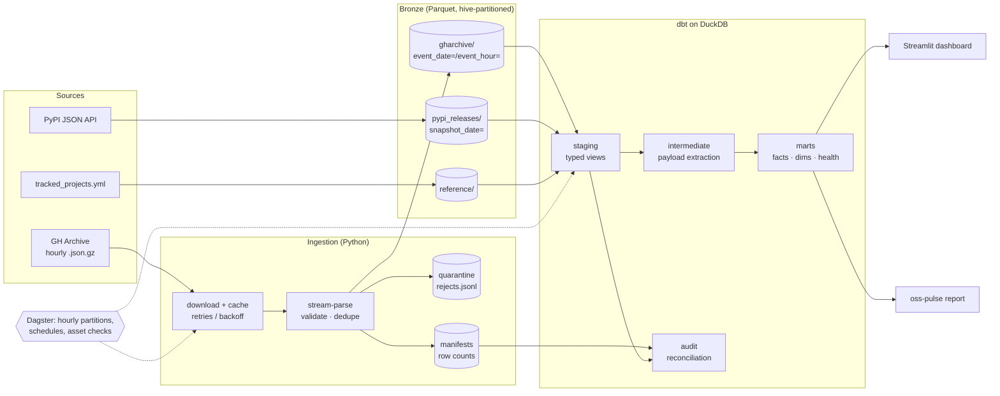
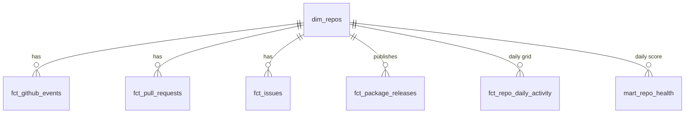

# OSS Pulse

**An open-source lakehouse that measures the health of open-source projects.**

OSS Pulse ingests the public [GH Archive](https://www.gharchive.org/) firehose (every public
GitHub event, published hourly) and the PyPI release API. It lands them as typed Parquet,
models them with dbt on DuckDB, and publishes daily health metrics for a configurable set of
projects: time-to-merge, time-to-first-response, bus factor, release cadence, and a composite
health score.

It runs on a laptop in about 30 seconds, needs no cloud account, and runs fully offline in CI.

```
┌───────────────────────────────────────┬────────────┬──────────────┬──────────┬───────────────┬───────────────────────┬────────────────────────────────┬────────────┐
│               repo_name               │ as_of_date │ health_score │ stars_7d │ prs_merged_7d │ median_hours_to_merge │ median_hours_to_first_response │ bus_factor │
├───────────────────────────────────────┼────────────┼──────────────┼──────────┼───────────────┼───────────────────────┼────────────────────────────────┼────────────┤
│ delta-io/delta-rs                     │ 2026-11-02 │         70.5 │      386 │            79 │                  11.4 │                            5.4 │          3 │
│ dagster-io/dagster                    │ 2026-11-02 │         65.5 │      461 │            95 │                 10.72 │                           4.87 │          1 │
│ apache/iceberg-python                 │ 2026-11-02 │         63.6 │      451 │           104 │                10.90 │                           5.11 │          1 │
│ …                                     │            │              │          │               │                       │                                │            │
└───────────────────────────────────────┴────────────┴──────────────┴──────────┴───────────────┴───────────────────────┴────────────────────────────────┴────────────┘
```
<sub>Output of `oss-pulse demo` (synthetic data). Run against real GH Archive hours for real numbers.</sub>

---

## Architecture



| Layer | Tech | What it does |
|---|---|---|
| Ingestion | Python, httpx, PyArrow | Streams each hourly archive into one Parquet partition with bounded memory. Bad records go to quarantine, duplicates are dropped, and every partition gets a manifest. |
| Storage | Parquet + zstd, Hive partitioning | Bronze is the source of truth. DuckDB queries it in place, with no load step. |
| Transform | dbt-core + dbt-duckdb | Staging → intermediate → marts. Incremental facts, an enforced model contract, and 35 data tests. |
| Orchestration | Dagster | Software-defined assets. Hourly partitions map 1:1 to GH Archive files, so a backfill is a range selection in the UI. dbt tests run as asset checks. |
| Quality | dbt tests, reconciliation, pytest | Manifest-vs-lake reconciliation, a reject-rate budget, referential integrity, and an end-to-end test on synthetic data. |
| Serving | Streamlit, CLI | Leaderboard, per-repo trends, PR drill-down. |
| CI | GitHub Actions | Lint, a test matrix on Python 3.11 to 3.13, a full pipeline run, Dagster validation, and dbt docs as a build artifact. |

## Quickstart

```bash
git clone https://github.com/<you>/oss-pulse && cd oss-pulse
python -m venv .venv && source .venv/bin/activate
make install

make demo        # synthetic data → bronze → dbt build → leaderboard  (offline, ~30s)
make dashboard   # http://localhost:8501
make dagster     # http://localhost:3000  (asset graph, partitions, backfills)
make docs        # http://localhost:8080  (dbt lineage graph)
```

### Real data

```bash
make ingest START=2026-10-01T00 END=2026-10-02T00   # 24 GH Archive hours (a few GB to download)
make transform && make report
```

Or with Docker:

```bash
docker compose up   # Dagster on :3000, dashboard on :8501
```

To track a different set of projects, edit [`tracked_projects.yml`](tracked_projects.yml) and
run `make transform`. No code changes are needed: bronze keeps the full firehose, and the
filtering happens in dbt.

## Data model



| Model | Grain | Notes |
|---|---|---|
| `fct_github_events` | event | Incremental (`delete+insert` on partition date), deduplicated across hours |
| `fct_pull_requests` | repo × PR | Lifecycle and `hours_to_merge`. Handles PRs opened before the loaded window. |
| `fct_issues` | repo × issue | `hours_to_first_response` = first comment by someone other than the author |
| `fct_package_releases` | package × version | Release cadence (`days_since_previous_release`) |
| `fct_repo_daily_activity` | repo × day | Zero-filled date spine, so days with no activity don't silently drop out of averages |
| `mart_repo_health` | repo × day | **Contract-enforced** public interface. Trailing 7-day metrics plus the score. |
| `audit_ingestion_reconciliation` | ingested hour | Manifest row counts vs. rows actually in the lake |

### Metric definitions

- **Bus factor**: the smallest number of contributors who account for at least 50% of pushes and opened PRs in the window.
- **Median hours to merge**: over PRs merged in the window.
- **Median hours to first response**: over issues that received their first non-author comment in the window.
- **Health score (0 to 100)**: a weighted percentile rank against the other tracked repos on the same day. Weights: stars 20%, merged PRs 20%, merge latency 15%, response latency 15%, bus factor 20%, release recency 10%. Latency metrics are inverted, so lower is better. Missing values rank worst; they are never dropped.

## Engineering decisions

**Idempotent by construction.** The unit of work is one archive hour, which writes one
partition. Writes go to a temp file followed by `os.replace`, so a crashed job never leaves a
half-written partition, and re-running an hour overwrites it instead of appending. This is
tested in `tests/test_gharchive.py`.

**Bronze stores JSON payloads as text.** GitHub changes event payloads over time. Storing
`payload` as raw JSON means upstream drift can't break ingestion. Field extraction happens in
dbt (`int_*` models), where it can be seen and tested, and missing fields are handled with
`try_cast` and `coalesce`.

**Quarantine, don't crash.** Malformed lines and contract violations are written to
`_quarantine/…/rejects.jsonl` with a reason. A dbt test fails the build when an hour's reject
rate exceeds a budget (`max_reject_rate`, set in `dbt_project.yml`).

**Reconciliation.** Each partition writes a manifest with read, written, rejected and
duplicate counts. `audit_ingestion_reconciliation` compares the manifests with what is
actually in the lake, which catches partial writes and manual tampering.

**Incremental with late-data tolerance.** `fct_github_events` reprocesses everything from the
latest loaded partition date forward, using `delete+insert`. Re-landing an hour or receiving a
late file needs no full refresh. This is tested in `tests/test_pipeline_e2e.py`.

**Synthetic data in the real format.** `oss_pulse.ingest.synthetic` writes byte-compatible GH
Archive `.json.gz` files, with dirty records injected on purpose. They go through the same
code path as production data, so CI checks the real pipeline end to end, offline, in seconds.

**No dbt package dependencies.** Surrogate keys and generic tests (`expression_is_true`,
`value_between`, `unique_combination`) are small local macros.

## Project layout

```
src/oss_pulse/
  ingest/gharchive.py     download → stream-parse → bronze partition (+ quarantine, manifest)
  ingest/pypi.py          PyPI snapshots + reference table
  ingest/synthetic.py     deterministic GH Archive-format test data
  ingest/schema.py        Arrow contracts for bronze
  orchestration/          Dagster assets, partitions, schedules
  cli.py                  `oss-pulse` CLI
transform/                dbt project (staging / intermediate / marts / audit)
dashboard/app.py          Streamlit
tests/                    unit + end-to-end
```

## Roadmap

See [ROADMAP.md](ROADMAP.md). It is a staged plan to take this from a laptop lakehouse to a
cloud-scale platform.

## License

MIT
