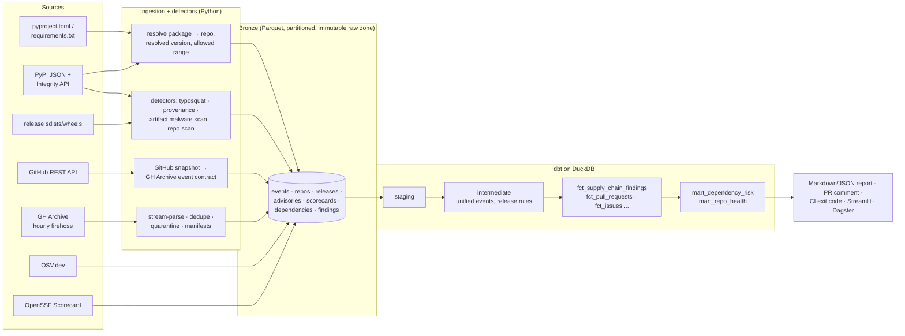

# OSS Pulse

**Catch supply-chain attacks in your Python dependencies, and in any repo you're about to open, before they run.**

Recent attacks have reached developers through:

- hijacked maintainer accounts publishing poisoned new versions of trusted packages (the Shai-Hulud worm, the Qix npm phishing takeover, Nx)
- malicious code that existed **only in the PyPI release** and never in git (Ultralytics)
- mutable CI tags (tj-actions)
- fake job-interview "coding assignments" that run malware the moment you open the folder (Contagious Interview). Binance's 2026 incident reportedly involved this kind of developer-machine entry point.

OSS Pulse looks for the traces those attacks leave. It is a data pipeline: it collects signals from PyPI, GitHub, OSV.dev, OpenSSF Scorecard and the release files themselves, models them with dbt on DuckDB, and gives you an explainable risk report and a CI gate.

```bash
pip install git+https://github.com/<you>/oss-pulse

oss-pulse scan ./take-home-assignment     # inspect an untrusted repo BEFORE opening it
oss-pulse check requirements.txt          # supply-chain risk of your dependencies
oss-pulse rules                           # every rule, why it matters, which attack used it
```

## What it detects

### `oss-pulse check`: your dependencies

| Question | Signals | Source |
|---|---|---|
| **Is it known-bad?** | Known malicious package (`MAL-` advisories), vulnerable resolved version, a version range that still allows vulnerable versions | OSV.dev |
| **Is it impersonating something?** | Typosquats (`reqeusts`, `python-dateutils`), affix squats (`requests-py`), dependency confusion for your internal names, brand-new packages | Top-15k PyPI list, PyPI |
| **Was this release hijacked?** | Trusted-Publishing provenance **lost** compared with the previous release; provenance from a **different repo**; release only hours old; release after long dormancy; no matching git tag | PyPI Integrity API (PEP 740), PyPI, GitHub |
| **Does the release contain malware?** | Static scan of the actual sdist and wheel: install-time network calls in `setup.py`, executable `.pth` files, `exec(b64decode(...))`, env-var dumps, credential and crypto-wallet theft, Discord/Telegram exfiltration, clipboard hijackers | PyPI files (verified by SHA-256) |
| **Is it likely to become a problem?** | Archived repo, no commits, stale releases, bus factor 1, unanswered issues, unmerged PRs, dangerous CI workflows / low OpenSSF Scorecard | GitHub API, OpenSSF Scorecard |

### `oss-pulse scan`: an untrusted folder (no network, nothing executed)

- **Auto-run on open:** `.vscode/tasks.json` with `runOn: folderOpen`, or workspace settings that enable automatic tasks. This is the Contagious Interview delivery method.
- **Run on install:** npm `preinstall`/`postinstall` hooks, especially ones that fetch remote code; `setup.py` side effects; `.pth` files; committed git hooks.
- **Hidden payloads:** obfuscated JS/Python, code pushed off-screen with whitespace, scripts disguised as `.png`/`.woff` files, binaries.
- **Stealers:** wallet and browser data access, environment dumps, exfiltration endpoints.
- **Typosquatted dependencies** in `requirements.txt` / `pyproject.toml`.
- **Unsafe GitHub Actions:** `pull_request_target` with a PR checkout (Nx), `${{ github.event.* }}` injection in `run:` (Ultralytics), actions not pinned to a commit SHA (tj-actions), caches in release jobs.

Every finding comes with a rule ID, the file and line, an evidence snippet, and the real attack that used the technique. The full catalogue is in [docs/RULES.md](docs/RULES.md).

### Example (synthetic scenario from the test suite)

```
| | Package      | Version | Why                                                                |
|---|------------|---------|--------------------------------------------------------------------|
| 🔴 | corp-utils | –       | CONF-001: Internal package name exists on public PyPI               |
| 🔴 | evil-lib   | 0.2     | OSV-MAL: Known malicious package                                   |
| 🟠 | hijacked-lib | 3.0   | CODE-EXFIL, CODE-OBF, CODE-PTH, CODE-SETUP, PROV-001: provenance     |
|    |            |         | disappeared, REL-001: very recent release, REL-002: after 500 days  |
|    |            |         | of dormancy, REL-003: no matching git tag                          |
| 🟠 | reqeusts   | 0.0.1   | TYPO-001: one edit away from 'requests'; first published 5 days ago |
| 🟡 | range-lib  | 2.0     | OSV-RANGE: `range-lib>=1.0` still allows a vulnerable version       |
| 🟢 | healthy-lib | 1.5.0 🔏 | –                                                                |
```

## Use it in CI

```yaml
- uses: actions/checkout@v4
- uses: <you>/oss-pulse@<commit-sha>
  with:
    dependency-file: requirements.txt
    fail-on: high
    internal-packages: acme-auth, acme-utils
```

It posts one PR comment that is updated on each push. Run it weekly as well, because new advisories and hijacks appear without any change on your side. See [docs/github-action.md](docs/github-action.md). This repository runs it on itself ([`supply-chain.yml`](.github/workflows/supply-chain.yml)).

---

## How it works (the data engineering)



| Layer | Tech | Highlights |
|---|---|---|
| Ingestion | Python, httpx, PyArrow | Two ingestion paths (GH Archive firehose, GitHub REST API) write **one bronze event contract**. Raw API responses are cached in an immutable raw zone, so re-runs make zero requests and every row traces back to the response it came from. |
| Detectors | Python AST + regex | Never execute untrusted code. Archives are read in memory (no extraction, no symlinks), downloads are verified against PyPI's SHA-256, and size limits are enforced. Rules were tuned on real packages: `requests`, `urllib3` and `pyyaml` produce no false positives. |
| Storage | Parquet + zstd, Hive partitions | Atomic writes, idempotent partitions, per-partition manifests, quarantine for bad records. |
| Transform | dbt-core + dbt-duckdb | 26 models and 50 data tests, an incremental fact with late-data handling, an enforced contract on the public health mart, and reconciliation of lake contents against manifests. Thresholds are dbt vars. |
| Orchestration | Dagster | Hourly-partitioned GH Archive assets for the ecosystem pipeline; dbt models as assets, dbt tests as asset checks. |
| Quality | pytest (50 tests) | An offline end-to-end test runs every detector against a fake internet with one fictional package per attack pattern, and asserts zero findings on the benign one. |
| CI/CD | GitHub Actions | Lint, a test matrix on Python 3.11 to 3.13, the full pipeline, a composite Action, and dogfooding on its own repo. |

### Engineering decisions worth discussing

- **Degrade loudly, never silently.** If GitHub, OSV or Scorecard is unreachable the check still runs, and the report says exactly which signal is missing ("GitHub not reachable" is never reported as "repository not found"). `--strict` turns any missing signal into a CI failure.
- **Precision over recall on popular code.** A noisy security tool gets switched off. Rules that legitimate libraries trigger (reading `~/.aws/credentials`, `dict(os.environ)` for subprocesses, `cmdclass` for C extensions) only fire in combination with stronger signals, or at low severity. Tests and docs inside release artifacts are skipped, because pip neither installs nor runs them.
- **Scan what pip installs, not what GitHub shows.** In the Ultralytics attack the malicious code was only in the PyPI artifact, so the scanner downloads the real sdist and wheel.
- **Absolute, explainable rules.** Every risk level comes with reasons a human can verify. There is no opaque score.
- **One findings contract.** Python detectors, OSV advisories and SQL release rules all land in `fct_supply_chain_findings`, so adding a detector requires no reporting changes.

### Also included: ecosystem health analytics

The same lakehouse can ingest the full GH Archive firehose and track the health of any set of projects over time (`oss-pulse demo`, `make dashboard`, `make dagster`). This is the original batch pipeline with hourly partitions, backfills, a contract-enforced daily health mart, and a Streamlit dashboard.

## Development

```bash
python -m venv .venv && source .venv/bin/activate
make install      # editable install with dev, orchestration and dashboard extras
make test         # 50 tests, fully offline
make demo         # ecosystem pipeline on synthetic GH Archive data
oss-pulse check pyproject.toml -v
```

Set `GITHUB_TOKEN` for 5,000 GitHub API requests per hour (60 without one).

## Limitations (honest ones)

- It is static analysis plus metadata. A determined attacker can evade heuristics, so treat a clean report as "no known red flags", not "safe".
- It covers Python dependencies and repository contents. It does not check Homebrew, npm dependency trees, IDE extensions, or what is already running on your machine.
- Only direct dependencies are checked; lockfile and transitive support is on the [roadmap](ROADMAP.md).

## License

MIT
