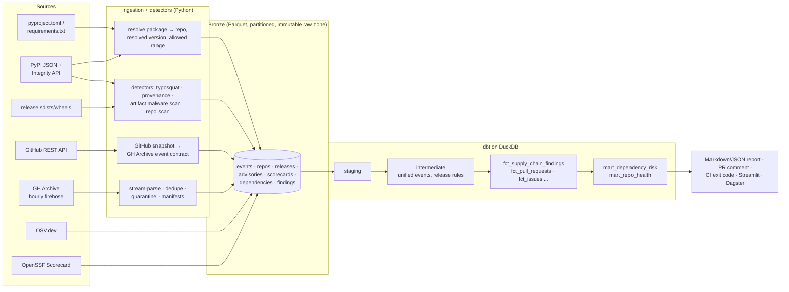

<p><picture>
  <source media="(prefers-color-scheme: dark)" srcset="docs/brand/logo-dark.svg">
  
</picture></p>

Triage for code you didn't write.

oss-pulse reads a repository someone sent you, or the Python packages you are about to install, and runs none of it. It tells you what would run, and when, and quotes the lines that say so.

Some fake job interviews send a take-home that runs code before you read a line of it. A VS Code task marked `"runOn": "folderOpen"` starts when you trust the folder, and an npm `postinstall` script runs during `npm install`. Security researchers named this the Contagious Interview campaign in 2023. `oss-pulse scan` reads the folder without opening it and needs no network.

```sh
pip install git+https://github.com/zahmed333/oss-pulse
oss-pulse scan ~/take-home --fail-on high   # a folder someone sent you
oss-pulse check requirements.txt            # the packages you are about to install
oss-pulse rules                             # what each rule matches, and the attack it came from
```

oss-pulse is not on PyPI yet. Install it from this repository, as above.

## What scan looks for

A folder under inspection never configures its own scan: an `.osspulseignore` inside it is reported, not applied. Nothing in the folder is executed.

- Code that runs when the folder opens: VS Code tasks with `runOn: folderOpen`, and workspace settings that switch on automatic tasks.
- Code that runs on install: npm `preinstall` and `postinstall` hooks, `setup.py` side effects, `.pth` files, committed git hooks.
- Code that hides: JavaScript in files named `.woff2` or `.png`, payloads pushed off-screen with whitespace, obfuscated loaders.
- Code that steals: wallet and browser data access, environment dumps, Discord and Telegram endpoints.
- Lookalike dependency names, and GitHub Actions that check out pull-request code in `pull_request_target` or put `${{ github.event.* }}` into a shell.

## What check looks for

For each dependency, check collects signals from PyPI, the release files themselves, GitHub, OSV.dev and OpenSSF Scorecard, models them with dbt on DuckDB, and reports the rule, the evidence and the source:

- OSV lists it as malicious, or the version you get has a known advisory.
- The name is a lookalike of a popular package, or your internal package name exists on public PyPI.
- A release was uploaded without the Trusted Publishing attestation the previous one had, came after a long quiet period, or has no matching git tag.
- The sdist or wheel pip would install contains install-time network calls, executable `.pth` files or decoded-and-executed code. Ultralytics 8.3.41 (December 2024) shipped such code only in the PyPI release, never in git.
- Upkeep: archived repository, no recent commits, one maintainer. Upkeep is never reported as a threat.

If GitHub, OSV or Scorecard can't be reached, the report says which signal is missing. `--strict` makes that fail the run. Every rule, with the incident it came from, is in [docs/RULES.md](docs/RULES.md).

## In CI

```yaml
- uses: actions/checkout@v4
- uses: zahmed333/oss-pulse@<commit-sha>
  with:
    dependency-file: requirements.txt
    fail-on: high
    internal-packages: acme-auth, acme-utils
```

The Action posts one PR comment and updates it on each push. Pin it to a commit SHA. See [docs/github-action.md](docs/github-action.md); this repository runs it on itself in [supply-chain.yml](.github/workflows/supply-chain.yml).

## How it works (the data engineering)



| Layer | Tech | Highlights |
|---|---|---|
| Ingestion | Python, httpx, PyArrow | Two ingestion paths (GH Archive firehose, GitHub REST API) write **one bronze event contract**. Raw API responses are cached in an immutable raw zone, so re-runs make zero requests and every row traces back to the response it came from. |
| Detectors | Python AST + regex | Never execute untrusted code. Archives are read in memory (no extraction, no symlinks), downloads are verified against PyPI's SHA-256, and size limits are enforced. Rules were tuned against real releases; on the 250 most-downloaded PyPI packages the current rules still flag 16% at medium or above, and the fix that brings that to zero is the first item on the [roadmap](ROADMAP.md). |
| Storage | Parquet + zstd, Hive partitions | Atomic writes, idempotent partitions, per-partition manifests, quarantine for bad records. |
| Transform | dbt-core + dbt-duckdb | 26 models and 50 data tests, an incremental fact with late-data handling, an enforced contract on the public health mart, and reconciliation of lake contents against manifests. Thresholds are dbt vars. |
| Orchestration | Dagster | Hourly-partitioned GH Archive assets for the ecosystem pipeline; dbt models as assets, dbt tests as asset checks. |
| Quality | pytest | An offline end-to-end test runs every detector against a fake internet with one fictional package per attack pattern, and asserts zero findings on the benign one. |
| CI/CD | GitHub Actions | Lint, a test matrix on Python 3.11 to 3.13, the full pipeline, a composite Action, and dogfooding on its own repo. |

### Engineering decisions worth discussing

- Degrade loudly, never silently. If GitHub, OSV or Scorecard is unreachable the check still runs, and the report says exactly which signal is missing ("GitHub not reachable" is never reported as "repository not found"). `--strict` turns any missing signal into a CI failure.
- Precision over recall on popular code. A noisy security tool gets switched off. Rules that legitimate libraries trigger (reading `~/.aws/credentials`, `dict(os.environ)` for subprocesses, `cmdclass` for C extensions) only fire in combination with stronger signals, or at low severity. Tests and docs inside release artifacts are skipped, because pip neither installs nor runs them.
- Scan what pip installs, not what GitHub shows. In the Ultralytics attack the malicious code was only in the PyPI artifact, so the scanner downloads the real sdist and wheel.
- Absolute, explainable rules. Every risk level comes with reasons a human can verify. There is no opaque score.
- One findings contract. Python detectors, OSV advisories and SQL release rules all land in `fct_supply_chain_findings`, so adding a detector requires no reporting changes.

### Also included: ecosystem health analytics

The same lakehouse can ingest the full GH Archive firehose and track the health of any set of projects over time (`oss-pulse demo`, `make dashboard`, `make dagster`). This is the original batch pipeline with hourly partitions, backfills, a contract-enforced daily health mart, and a Streamlit dashboard.

## Development

```bash
python -m venv .venv && source .venv/bin/activate
make install      # editable install with dev, orchestration and dashboard extras
make test         # fully offline
make demo         # ecosystem pipeline on synthetic GH Archive data
oss-pulse check pyproject.toml -v
```

Set `GITHUB_TOKEN` for 5,000 GitHub API requests per hour (60 without one).

## Limitations (honest ones)

- It is static analysis plus metadata. A determined attacker can evade heuristics, so treat a clean report as "no known red flags", not "safe".
- It covers Python dependencies and repository contents. It does not check Homebrew, npm dependency trees, IDE extensions, or what is already running on your machine.
- Only direct dependencies are checked; lockfile and transitive support is on the [roadmap](ROADMAP.md).

## License

MIT
