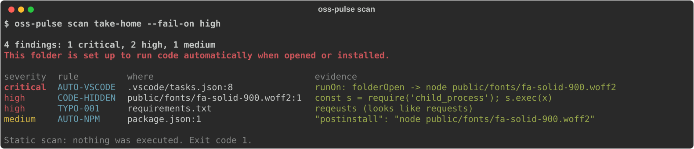
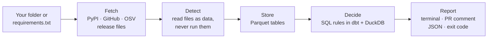

<div align="center">

<picture>
  <source media="(prefers-color-scheme: dark)" srcset="docs/brand/logo-dark.svg">
  
</picture>

### Check code for malware before you run it

Scan a folder someone sent you, or your Python dependencies, for supply-chain attacks.<br>
Nothing is executed. Every finding points to the file, the line and the bytes that matched.

[](https://github.com/zahmed333/oss-pulse/actions/workflows/ci.yml)
[](https://github.com/zahmed333/oss-pulse/actions/workflows/supply-chain.yml)
[](pyproject.toml)
[](LICENSE)

[Quick start](#quick-start) · [What it checks](#what-it-checks) · [CI/CD](#in-ci) · [How it works](#how-it-works) · [FAQ](#faq) · [Roadmap](ROADMAP.md)



</div>

## Why

oss-pulse is built for two attacks that antivirus and vulnerability scanners don't catch.

| Attack | What happens | Why other tools miss it |
|---|---|---|
| Fake job-interview take-home ("Contagious Interview", named in 2023) | A recruiter sends a coding test. `.vscode/tasks.json` runs a script disguised as a font file the moment you trust the folder in VS Code. | It is a text file in a project, so antivirus ignores it. |
| Poisoned release of a trusted package (Ultralytics 8.3.41, December 2024) | A new version on PyPI contains a crypto miner. The code exists only in the PyPI download, never in the GitHub repository. | pip-audit and Dependabot only know about vulnerabilities after someone files one. |

## Quick start

```sh
pip install git+https://github.com/zahmed333/oss-pulse   # not on PyPI yet

oss-pulse scan ~/take-home --fail-on high   # a folder someone sent you
oss-pulse check requirements.txt            # the packages you are about to install
oss-pulse rules                             # every rule, and the attack it comes from
```

`scan` exits 1 when it finds something at or above `--fail-on`, so `oss-pulse scan ~/take-home --fail-on high && code ~/take-home` only opens a folder that passed. The example above is an inert fixture from the test suite; nothing in it is real malware.

## How it works



Fetch the data, read the code without running it, store everything in tables, apply the rules in SQL, report. The [architecture section](#architecture) explains why each step exists.

## What it checks

`oss-pulse scan <folder>` needs no network and never executes anything in the folder. It looks for:

- tasks and settings that make VS Code run code when the folder opens;
- npm install hooks, `setup.py` side effects, `.pth` files and git hooks that run on install or commit;
- code hidden in fake font or image files, or pushed off-screen with whitespace;
- reads of wallet files, browser passwords, SSH keys and environment variables, and Discord or Telegram upload URLs;
- misspelled dependency names, and GitHub Actions workflows that can be hijacked by a pull request.

A folder can't switch these checks off: an `.osspulseignore` file inside it is reported as a finding, not obeyed.

`oss-pulse check <requirements.txt | pyproject.toml>` looks at each dependency:

- whether OSV.dev lists it as malicious, or the version you'd get has a known advisory;
- whether its name imitates a popular package, or your company's internal package name has appeared on public PyPI (dependency confusion);
- whether the newest release looks hijacked: it lost the PyPI Trusted Publishing attestation the previous release had, it came after a long silence, or it has no matching git tag;
- what the actual files pip would download contain, so code that exists only on PyPI (the Ultralytics case) is still caught;
- whether the project is still maintained (archived, no commits, a single maintainer). These are reported as maintenance issues, not as attacks.

If GitHub, OSV or Scorecard can't be reached, the report says which source was missing. Every rule and its source incident is in [docs/RULES.md](docs/RULES.md).

## In CI

oss-pulse works in any CI system. It exits non-zero at the level you choose, and writes JUnit (test results), SARIF (code scanning) and native log annotations, so findings show up where each system already shows problems.

| CI system | How |
|---|---|
| Azure DevOps | Step template [`ci/azure-pipelines/oss-pulse.yml`](ci/azure-pipelines/oss-pulse.yml): Tests tab, build summary, file/line errors, SARIF artifact, one pull-request comment |
| GitHub Actions | The `zahmed333/oss-pulse` Action: PR comment, job summary, file/line annotations |
| GitLab CI | Include [`ci/gitlab/oss-pulse.gitlab-ci.yml`](ci/gitlab/oss-pulse.gitlab-ci.yml): merge request test report |
| Jenkins and others | `oss-pulse scan . --junit results.xml` and your JUnit publisher |

Azure DevOps:

```yaml
resources:
  repositories:
    - repository: osspulse
      type: github
      name: zahmed333/oss-pulse
      endpoint: github
steps:
  - template: ci/azure-pipelines/oss-pulse.yml@osspulse
    parameters:
      dependencyFile: requirements.txt
      failOn: high
      internalPackages: [contoso-billing]
```

GitHub Actions:

```yaml
- uses: actions/checkout@v4
- uses: zahmed333/oss-pulse@<commit-sha>   # pin to a commit, not a tag
  with:
    dependency-file: requirements.txt
    fail-on: high
```

Setup, parameters, permissions and private feeds for each system are in [docs/ci.md](docs/ci.md).

## FAQ

### How do I check if a coding assignment from a recruiter is malware?

Before you open it, run `oss-pulse scan <folder>`. It reads the folder without executing anything and reports VS Code tasks that run on open (`"runOn": "folderOpen"`), npm `postinstall` hooks, scripts disguised as fonts or images, and code that reads wallets, browser passwords or SSH keys. If it reports anything at critical or high, don't open the folder in VS Code and don't run `npm install`. If VS Code asks whether you trust the authors, choose "No, I don't trust the authors": tasks don't run in Restricted Mode.

### What is the Contagious Interview attack?

A campaign, named by security researchers in 2023, in which fake recruiters send developers a take-home project that runs malware when the folder is opened or its dependencies are installed. It targets developers in crypto and Web3, and often steals wallet and browser data.

### How do I detect a malicious or typosquatted PyPI package?

Run `oss-pulse check requirements.txt` (or `pyproject.toml`). For each dependency it checks OSV.dev for known-malicious packages, compares the name against the 15,000 most downloaded PyPI packages to catch lookalikes such as `reqeusts`, and scans the actual sdist and wheel pip would download for install-time code, `.pth` files and decoded-and-executed payloads.

### How can I tell if a PyPI release was hijacked?

`check` compares the newest release with the one before it. Warning signs it reports: the release lost the PyPI Trusted Publishing attestation (PEP 740) the previous release had, it was attested from a different repository than the one the project links to, it appeared after a long quiet period, or it has no matching git tag.

### How is this different from pip-audit, Dependabot or OSV-Scanner?

Those look up known vulnerabilities in a database. oss-pulse also reads the code and release files themselves, so it can flag a malicious release on the day it is published, before anyone has filed an advisory, and it can vet a whole folder before you open it. Use it alongside a vulnerability scanner, not instead of one.

### How do I block malicious dependencies in Azure DevOps, GitHub Actions or GitLab?

Add oss-pulse to the pipeline (see [In CI](#in-ci)) with a fail level such as `high`. Pull requests that add a high-risk dependency fail; findings appear in the Tests tab or test report, as file and line errors, and in one pull-request comment.

### Does it run or upload my code?

No. `scan` makes no network requests. `check` sends package names to PyPI, OSV.dev, GitHub and OpenSSF Scorecard to look them up, and nothing else. Neither command executes code from what it inspects.

## Architecture

`scan` is plain Python with no network access. `check` is a small data pipeline, because its rules need data from several sources at once.

One check pulls data from seven sources: your dependency file, PyPI metadata, PyPI's attestation API, the release files, GitHub, OSV and Scorecard. Several rules need data from more than one of them. For example, "this release has no attestation, but the previous one did" compares two releases, and "this package links to repository X but was attested from repository Y" combines PyPI and GitHub data. Those rules are written as SQL joins.

| Step | What it does | Why it is needed |
|---|---|---|
| Fetch and cache (Python, httpx) | Downloads each source once and saves the raw response to disk | Re-running a check makes no new requests, and every finding can be traced to the exact response it came from, for example when a maintainer disputes a result. |
| Detectors (Python AST and regex) | Read release files and folders as data, in memory, with size limits and SHA-256 checks | Untrusted code must never be imported, unpacked to disk or run. |
| Bronze tables (Parquet) | Store all sources in one typed format, partitioned by date | Seven sources with different shapes become tables with fixed schemas. A source that changes its API breaks loudly here instead of silently producing wrong verdicts. |
| Rules and verdicts (dbt on DuckDB) | Join the sources and apply release and maintenance rules; dbt tests check the results | Rules live in reviewable SQL with tests, and thresholds such as "a release under 7 days old" are settings, not code edits. DuckDB runs inside the process: no database server. |
| Report | Markdown for PR comments, JSON for scripts, an exit code for CI | One table of findings feeds every output, so a new detector needs no reporting changes. |

The same storage also powers a second, separate use: tracking the health of open-source projects over time from the GH Archive event stream (`oss-pulse demo`, `make dashboard`, `make dagster`). That part uses Dagster for hourly scheduling and Streamlit for a dashboard. It is not needed for `scan` or `check`.

## How results are decided

A missing signal is reported, never guessed. If GitHub is unreachable, the report says "GitHub not reachable" rather than "repository not found", and `--strict` turns any missing source into a CI failure.

False positives are fixed like any other bug, because people stop using a tool that flags numpy. On the 250 most-downloaded PyPI packages, no package gets a finding at medium or above (down from 39), while all 24 attack shapes in the test suite are still caught. Method, numbers and limits are in [docs/benchmarks.md](docs/benchmarks.md).

Every result names its rule, file, line and the exact bytes that matched. There is no combined risk score.

## Development

```bash
python -m venv .venv && source .venv/bin/activate
make install      # editable install with dev, orchestration and dashboard extras
make test         # fully offline
make demo         # ecosystem pipeline on synthetic GH Archive data
oss-pulse check pyproject.toml -v
```

Set `GITHUB_TOKEN` for 5,000 GitHub API requests per hour (60 without one).

## Limitations

- It is static analysis plus metadata. A determined attacker can evade heuristics, so treat a clean report as "no known red flags", not "safe".
- It covers Python dependencies and repository contents. It does not check Homebrew, npm dependency trees, IDE extensions, or what is already running on your machine.
- Only direct dependencies are checked; lockfile and transitive support is on the [roadmap](ROADMAP.md).

## Contributing

Bug reports, false positives and missed detections are the most useful contributions. Open an issue with the command you ran and the output. New detection rules are welcome: each rule lives in `src/oss_pulse/supplychain/rules.py`, needs a test with an inert fixture, and is documented in [docs/RULES.md](docs/RULES.md). See [CONTRIBUTING.md](CONTRIBUTING.md); report security problems in oss-pulse itself as described in [SECURITY.md](SECURITY.md).

## License

MIT
