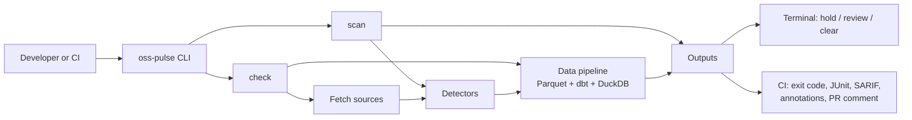
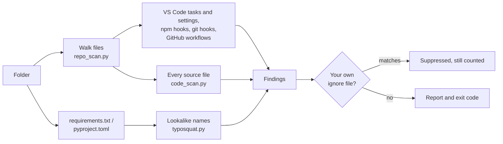
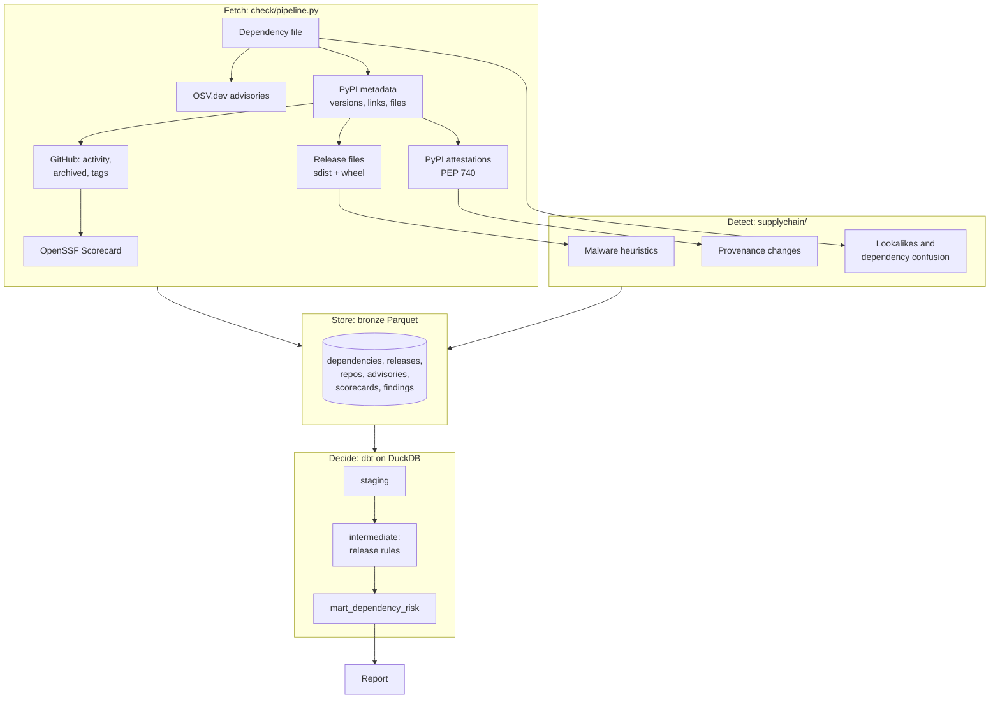

# Architecture

How oss-pulse is put together, why each part exists, and where to change things. For setup in CI see [ci.md](ci.md); for every rule see [RULES.md](RULES.md).

## The two commands

oss-pulse answers two different questions, so it has two paths that share detectors and output code.

| | `scan <folder>` | `check <requirements.txt \| pyproject.toml>` |
|---|---|---|
| Question | Will this folder run code on my machine if I open or install it? | Is anything I'm about to install malicious, hijacked or a lookalike? |
| Input | Files on disk | Package names and versions |
| Network | None | PyPI, plus GitHub, OSV.dev and OpenSSF Scorecard when reachable |
| Install | `pip install oss-pulse` (38 MB) | `pip install "oss-pulse[check]"` (adds DuckDB, PyArrow, dbt) |
| Typical time | Under a second | 10 to 60 seconds, mostly downloads |

Plain `oss-pulse` runs `scan` on the current folder, then `check` if the folder has a dependency file and the `[check]` extra is installed.



## scan: a folder, read as data



Each content check in `supplychain/code_scan.py` is one small function over a `SourceFile`, which knows whether the file is Python or JavaScript, build output, install-time code, and which function a line belongs to. Adding a rule means adding one function to `TEXT_CHECKS`.

Python files are parsed so that comments and docstrings don't count as code, and so a download and an `exec` only count together when they are in the same function. That is what keeps popular packages quiet: on the 250 most-downloaded PyPI packages, nothing is flagged at medium or above ([benchmarks.md](benchmarks.md)).

## check: dependencies, through a small data pipeline



Why a pipeline instead of plain Python: several rules compare data from more than one source. "This release lost the attestation the previous one had" compares two releases; "this package links to repository X but was attested from Y" joins PyPI with GitHub. Those are SQL joins in dbt, with tests, and the thresholds (such as "a release under 7 days old") are dbt variables rather than code.

What each step buys:

- Fetch caches every raw response on disk, so re-running makes no new requests and every finding traces back to the response it came from.
- Detect reads release archives in memory, never extracts or imports them, and checks each download against PyPI's SHA-256.
- Store writes typed Parquet tables with fixed schemas, so an API that changes shape fails loudly instead of producing wrong verdicts.
- Decide runs inside the process (DuckDB): no database server.

A source that can't be reached is reported as "not checked", never as a clean result. `--skip` avoids contacting blocked services, and `--strict` turns any missing source into a failure.

## Outputs

| Output | Code | Used by |
|---|---|---|
| Terminal view: verdict, evidence, next steps | `terminal.py` | people |
| Markdown report | `check/report.py`, `scan/report.py` | PR comments, job summaries, Azure DevOps build summary |
| JSON | same modules | scripts |
| JUnit XML | `ci/junit.py` | Azure DevOps Tests tab, GitLab, Jenkins |
| SARIF 2.1.0 | `ci/sarif.py` | GitHub code scanning, Azure DevOps Scans tab |
| Log annotations | `ci/providers.py` | file/line errors in Azure DevOps and GitHub Actions |
| Pull-request comment | `action.yml` (GitHub), `ci/pull_request.py` (Azure DevOps) | reviewers |

Exit codes are the same everywhere: 0 below `--fail-on`, 1 at or above it (default `high`), 2 when oss-pulse couldn't finish.

## Trust boundaries

oss-pulse reads code written by attackers, so the tool itself is a target. These rules hold everywhere:

1. Nothing it inspects is executed, imported or extracted to disk.
2. A scanned folder never configures the scan. An `.osspulseignore` inside it is reported as a finding (EVADE-IGNORE), not obeyed; your own file applies only when you pass `--ignore-file`.
3. Text quoted from scanned files goes through `safe_text.py` before it is printed: control characters, bidirectional overrides and zero-width characters become visible escapes, Markdown can't add links, images or mentions, and nothing can issue `::workflow-commands::` in GitHub Actions or `##vso[...]` commands in Azure Pipelines.
4. The only hosts contacted are the ones in `endpoints.py`, each overridable for a mirror or GitHub Enterprise Server. Internal package names passed with `--internal` are only checked for existence on public PyPI.

## Where the code lives

```
src/oss_pulse/
  cli.py                  builds the command from the modules below
  commands/
    easy.py               plain oss-pulse, init, accept
    security.py           scan, check, rules, doctor, pr-comment
    lakehouse.py          the separate GH Archive analytics commands
  scan/                   pipeline.py (named steps), ignore_file.py, report.py
  check/                  pipeline.py (named steps), versions.py, result.py, report.py
  supplychain/            detectors: code_scan, repo_scan, workflows, artifacts,
                          typosquat, provenance, rules (the catalogue), findings
  ingest/                 one client per source, plus bronze schemas and writers
  ci/                     JUnit, SARIF, annotations, Azure DevOps PR comments
  terminal.py             the verdict-first view
  safe_text.py            escaping for every untrusted string
  endpoints.py            every external host, and how to override it
  doctor.py               which hosts this machine can reach
transform/                dbt project: staging -> intermediate -> marts
ci/                       Azure DevOps and GitLab pipeline templates
action.yml                the GitHub Action
```

Detectors return findings and never store or print anything. Most take data in; the two that inspect what PyPI serves (`artifacts.py` for release files, `provenance.py` for attestations) download it through the HTTP client the pipeline passes them. The places that connect fetching, detection and output are `scan/pipeline.py` and `check/pipeline.py`, so a new detector or a new output format touches one place.

## Testing

| What | Where |
|---|---|
| Every detector, offline, against a fake internet with one fictional package per attack pattern | `tests/test_supply_chain.py`, `tests/fakes.py` |
| 37 precision and recall cases: real attack shapes must be caught, real popular-package code must stay quiet | `tests/test_artifact_precision.py` |
| Injection into terminals, Markdown, CI logs, JUnit and SARIF | `tests/test_supply_chain.py`, `tests/test_ci_outputs.py` |
| CI outputs, Azure DevOps PR comments, locked-down networks | `tests/test_ci_outputs.py`, `tests/test_network_setup.py` |
| Getting started: plain oss-pulse, init, accept, the slim install | `tests/test_easy_use.py` |
| What users install: the built wheel in a clean environment, with and without `[check]` | `wheel-smoke` job in `.github/workflows/ci.yml` |
| The repository passes its own scan | `tests/test_packaging.py`, CI |

## The other half: ecosystem analytics

The same storage and dbt project also track the health of open-source projects over time from the GH Archive event stream, with hourly Dagster schedules and a Streamlit dashboard (`oss-pulse demo`, `make dagster`, `make dashboard`). It shares the bronze layer and the `dim_repos` and activity models with `check`, but `scan` and `check` don't need it.
